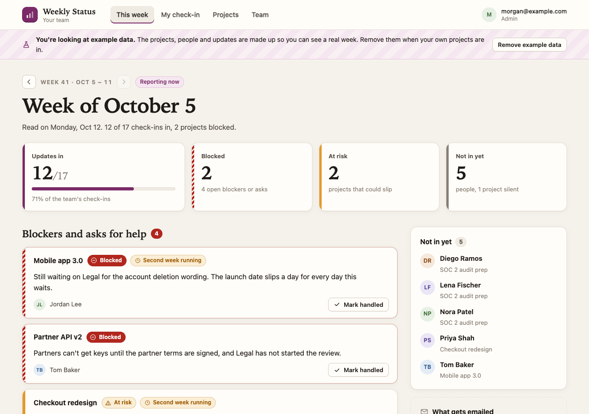
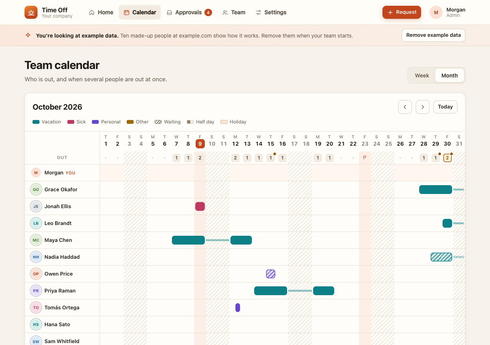
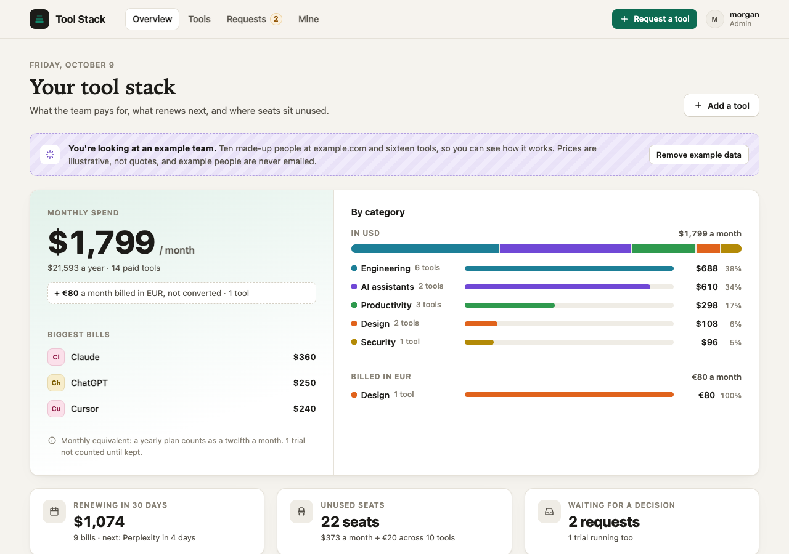

# Spryloom

The publish button for coding agents. Your agent builds a small app; Spryloom
runs it at a private address that only the people you invite can open, with a
database, scheduled jobs and email if the app asks for them. You don't set up
a server, a database or sign-in.

This repository holds everything Spryloom puts on your machine: the agent
skill, the setup for each coding agent, and the source of the `spry` command
line and its MCP server. The service that runs your apps is not in it.

## Install

You need Node.js 20.19 or later.

**Claude Code**, as a plugin:

```
/plugin marketplace add spryloom/spryloom
/plugin install spryloom@spryloom
```

**Codex, Cursor and other agents that read skills:**

```
npx skills add spryloom/spryloom
```

**Cursor**, for the MCP server: copy [`cursor/mcp.json`](cursor/mcp.json) into
your project's `.cursor/mcp.json`.

**Any MCP client:** run `npx -y spryloom mcp` over stdio.

**The command line:**

```
npm install -g spryloom
spry login --email you@yourcompany.com
spry publish .
```

Then ask your agent: "Publish this so my team can use it."

## Starters

Finished apps to publish as they are, or to hand to your coding agent and make
your own. Each runs locally against any Postgres, opens with example data
you can remove in one click, and works in light and dark and on a phone.

| Starter | For | What it does | Live demo |
|---|---|---|---|
| [Weekly Status](examples/weekly-status/) | Project and team leads | Everyone answers three questions per project on Friday. Blockers and missing updates come first, and admins get a Monday summary. | [Try it](https://weekly-status.spryloom-com.spryloom.app) |
| [Time Off](examples/time-off/) | Small companies | Request leave, approve it, see your balance, and see who's out on a team calendar. Weekends and company holidays aren't counted. | [Try it](https://time-off.spryloom-com.spryloom.app) |
| [Tool Stack](examples/tool-stack/) | Teams paying for AI and SaaS tools | What the team pays for each month, what renews next, which seats sit unused, and requests for new tools. | [Try it](https://tools.spryloom-com.spryloom.app) |

<p>
  <a href="examples/weekly-status/"></a>
  <a href="examples/time-off/"></a>
  <a href="examples/tool-stack/"></a>
</p>

The demos are shared by everyone who signs in, and go back to their example data every night.

Publish one straight from GitHub:

```
npx -y spryloom login --email you@yourcompany.com
npx -y spryloom publish github.com/spryloom/spryloom/tree/main/examples/weekly-status
```

## What's here

| Folder | What it is |
|---|---|
| [`skills/spryloom/`](skills/spryloom/) | The agent skill: how to write an app that publishes the first time, and how to publish it. |
| [`codex/`](codex/) | The Codex plugin: the same skill, written for the `spry` command rather than MCP tools. |
| [`cursor/`](cursor/) | MCP setup for Cursor. |
| [`.claude-plugin/`](.claude-plugin/) | A Claude Code marketplace. The plugin itself is published from [spryloom/claude-plugin](https://github.com/spryloom/claude-plugin), which carries the MCP server ready to run. |
| [`src/cli/`](src/cli/) | `spry`, the command line. |
| [`src/mcp/`](src/mcp/) | The MCP server and the tools it gives your agent. |
| [`src/manifest/`](src/manifest/) | Reads and checks `spryloom.yaml`, and the list of outside services an app may reach. |
| [`src/protocol/`](src/protocol/) | The requests the command line sends to Spryloom, and the answers it gets. |
| [`src/detect/`](src/detect/) | Works out how an app runs when its manifest doesn't say. |
| [`src/source/`](src/source/) | Packs a folder, a page or a GitHub repository for upload. |
| [`examples/`](examples/) | The starters above, one folder each. |

`src/` is the TypeScript the [`spryloom` npm package](https://www.npmjs.com/package/spryloom)
is compiled from, so you can read what the MCP server does before you install
it. It is published here to be read, and doesn't build on its own.

## How this repository is updated

It is generated from Spryloom's private repository on each release, one commit
per version. Issues are welcome. A pull request can't be merged here directly,
but we'll make the change upstream and credit you, and it will appear in the
next release.

Docs: [spryloom.com/docs](https://spryloom.com/docs) ·
Support: [hello@spryloom.com](mailto:hello@spryloom.com)

## Licence

[MIT](LICENSE).
