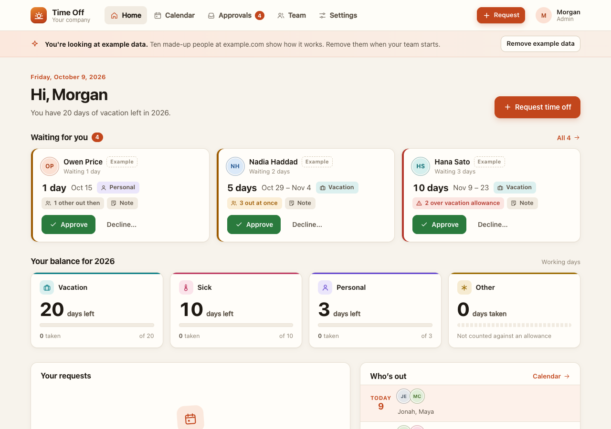
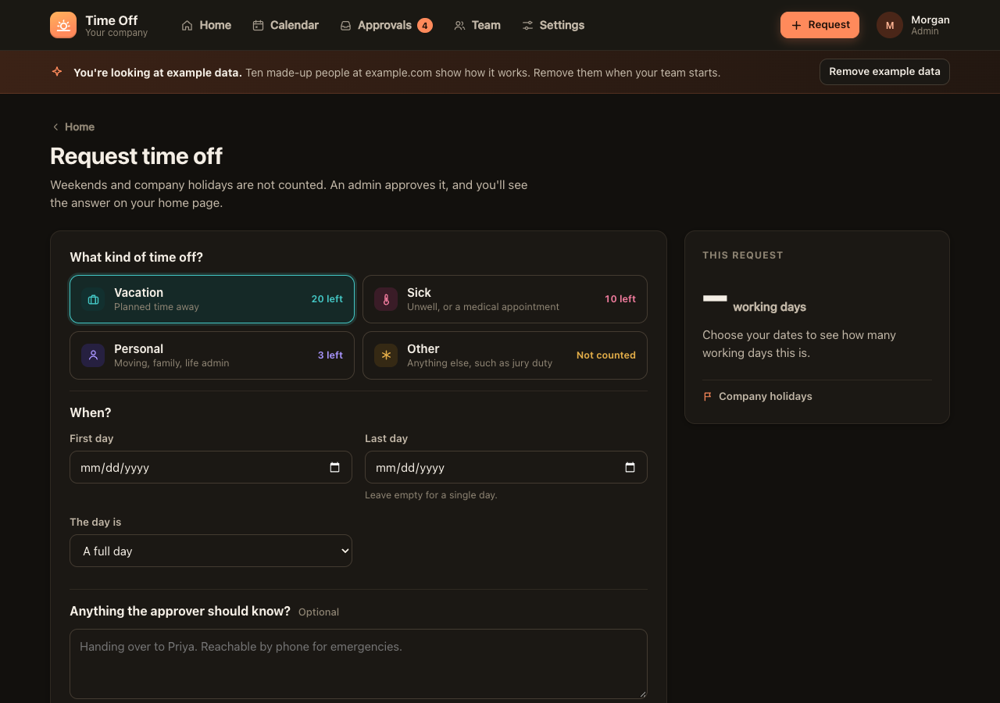
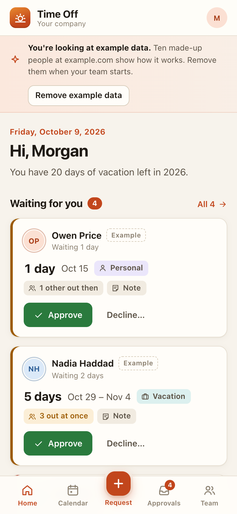

# Time Off

**Live demo:** [time-off.spryloom-com.spryloom.app](https://time-off.spryloom-com.spryloom.app). Sign in with your email to try it as a member of the example team. Anyone who signs in shares the demo, and it goes back to the example data every night.

Time off for a team of 10 to 50, without the spreadsheet. People ask for days
off and see their own balance without asking anyone. An admin approves or
declines with a reason, and everyone can see who is out this week.




<p>
  
  
</p>

```
Request → Waiting → Approved
                  ↘ Declined (with a reason)
Cancel any time before it starts; the days go back in the balance.
```

## What it does

- **Your balance at a glance.** Vacation, sick, personal and other, for this
  year: days left, taken and waiting. Counted in working days: weekdays, minus
  company holidays. Half days count as 0.5.
- **Asking takes one form.** Pick a type, a first and last day, a half day at
  either end, and an optional note. While you fill it in, the page shows how many
  working days it is, what it leaves in your balance, which holidays it skips,
  and who else is out then.
- **Approvers see what needs them first.** Waiting requests are on an admin's
  home page and on Approvals, soonest first, each showing the balance it would
  leave, whether it goes over, and who else is out on those days. Approve in one
  click; declining needs a reason, which the requester sees.
- **A team calendar.** A month grid with a bar per stretch of time off and a
  count of people out each day, marked when several people are out at once; and
  a week view that also works on a phone. Waiting requests are hatched, half days
  are half bars.
- **Allowances.** A company number per type, and a different number for one
  person (someone who joined mid-year, say). Leave a type empty to track it
  without a limit; "Other" starts that way.
- **Company holidays.** Add or remove them in Settings. Requests that include
  the day are recounted.
- **Privacy between coworkers.** Everyone sees who is out; only the person and
  the admins see the type of leave and the note.
- **Example data on first start.** An empty app fills itself with ten made-up
  people at example.com and requests around today's date, so the calendar has
  something to show. An admin removes all of it with one button; real data
  stays.

### The rules it follows

- **Nobody approves their own time off.** Another admin does, and the page says
  so. The exception: if you are the only admin who has opened the app, you can
  approve your own, and it is recorded as self-approved, so a founder alone at
  the top is never stuck.
- **Going over the balance is allowed, and flagged.** The requester is warned
  before sending, and the approver sees exactly how many days over it is.
  Whether that means unpaid days or borrowing from next year is the company's
  call, not the app's.
- **Vacation and personal time can't start in the past.** Sick days and "other"
  can be recorded up to 30 days back, because nobody books the flu in advance.
- **No overlapping your own requests**, to the half day: a morning off and a
  request starting that afternoon are fine together.
- **One request per calendar year**, so each counts against the right year.

## Email, and the limit of 5 a day

Spryloom lets each app send 5 emails a day (reset at midnight UTC), so email is
a nudge here, never the only place anything lives. Everything is on people's
home pages.

- A new request emails the admins who can approve it. A decision emails the
  requester.
- **A weekday job at 9:00** (`jobs/digest.js`, New York time; change
  `timezone` in `spryloom.yaml`) sends each approver one email listing how many
  requests wait for them, never one per request. If there are more approvers
  than emails left, those with the most urgent request go first.
- On weekdays the app keeps two of the day's five for that digest until it has
  run. When the allowance is used, the email is held, logged, and the request
  still shows on the approver's screen. Settings shows today's count.
- Example people are never emailed.

## Publish it

Add the people who approve to `access.admins` in `spryloom.yaml`, then:

```
spry publish .
spry invite time-off --email teammate@yourcompany.com
```

Or straight from GitHub:

```
spry publish github.com/spryloom/spryloom/tree/main/examples/time-off
```

The person who publishes is an admin. People appear on the Team page the first
time they open the app. Set your company name, timezone and holidays in
Settings, then remove the example data.

## Change it

Ask your coding agent things like: "add a Parental leave type with 60 days",
"let approvals go to each person's manager", "carry up to 5 unused vacation
days into next year", "start the year in April". Where things live:

| | |
|---|---|
| `lib/rules.js` | types, allowances, what a request may be, who decides, email limits |
| `lib/days.js` | dates and working-day counting |
| `lib/calendar.js` | who is out on which day |
| `lib/views.js` | every page |
| `lib/seed.js` | the example data |
| `jobs/digest.js` | the weekday email to approvers |
| `public/app.css`, `public/app.js` | styles, and the live summary on the request form |

```
npm install
npm test          rules, dates and the calendar, no database needed
```

## Run it locally

You need a Postgres. Nothing signs people in on your machine, so send the
identity headers Spryloom would send:

```
createdb timeoff
DATABASE_URL=postgres://localhost/timeoff PORT=3000 node server.js

curl -H 'x-spryloom-email: you@yourcompany.com' -H 'x-spryloom-role: admin' localhost:3000
curl -H 'x-spryloom-email: sam@yourcompany.com' -H 'x-spryloom-role: user' localhost:3000
```

For a browser, a header extension that sets the same two headers does it.
Emails are printed to the console, since there is no Spryloom to send them.
Run the job the same way: `DATABASE_URL=… node jobs/digest.js`.

## Not payroll

This tracks requests and balances in working days. It does not pay anyone,
accrue leave per pay period, carry days over, or know the leave laws where you
are. Check your local rules and keep payroll where it is.

---

MIT licensed. Part of [spryloom/spryloom](https://github.com/spryloom/spryloom).
