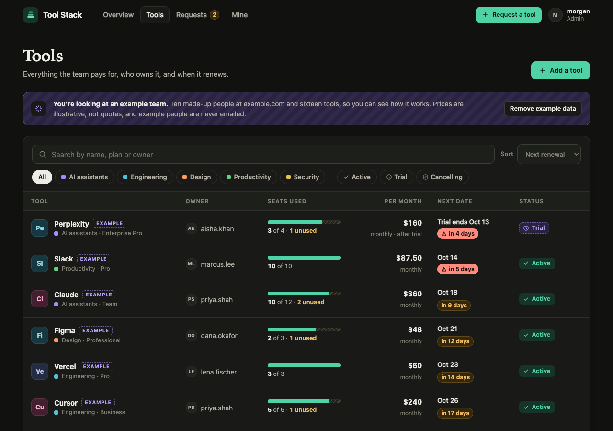
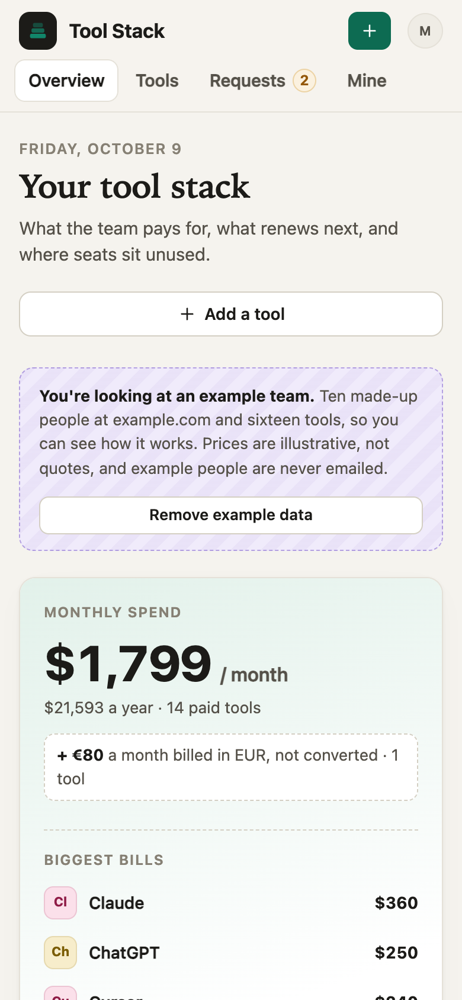

# Tool Stack

**Live demo:** [tools.spryloom-com.spryloom.app](https://tools.spryloom-com.spryloom.app). Sign in with your email to try it as a member of the example team. Anyone who signs in shares the demo, and it goes back to the example data every night.

One shared register of the AI and SaaS tools your team pays for: what each costs
a month, who owns it, how many seats are bought and used, and when it renews.
People ask for new tools here instead of in DMs, and an admin approves or
declines with a reason.


<p>
  
  
</p>

```
Request a tool or a seat → An admin approves (or declines, with a reason) → It's in the register
                                                                            ↓
                                    Weekday email before it renews or a trial ends
```

## What it does

- **Overview.** Monthly spend, with yearly plans counted as a twelfth a month
  and labelled that way, split by category on a chart drawn to scale. Then
  what renews or ends in the next 60 days, unused seats and what they cost,
  and a "Needs attention" list: renewals and trials ending inside two weeks,
  tools with no owner, seats nobody uses, requests waiting.
- **Money stays honest.** Prices are kept as whole cents with a currency per
  tool. Totals are grouped by currency and never converted: a team paying in
  dollars and euros sees both, side by side. Trials aren't counted until kept;
  a plan being cancelled is counted until it ends.
- **The register.** Every tool with its owner, plan, price per seat or flat,
  monthly or yearly billing, seats bought against people using it, next
  renewal and status (active, trial, cancelling). Search, filter by category
  and status, sort by renewal, cost or unused seats. Only admins change it.
- **Renewal dates roll forward.** Enter any renewal the tool has had; the app
  moves it on a month or a year at a time, counted from that date, so a plan
  bought on the 31st stays on month ends.
- **"I use this."** Everyone marks the tools they use, so seat counts are real
  and unused seats show up. The "Mine" page lists what you use and own, and
  asks about the tools you haven't marked. Admins can free a seat.
- **Requests.** Ask for a new tool (what for, rough cost, how many people) or a
  seat on one the team has. Asking for a tool already in the register sends
  you to the seat form instead. The request page shows the admin what the team
  already pays for in that category, and for a seat, whether a seat is free so
  nothing new needs buying.
- **Decisions.** An admin approves or declines; a decline needs a reason, which
  the person who asked sees. An approved tool joins the register with the
  requester marked as using it; an approved seat adds them to the tool and
  buys a new seat only if the admin says so. An admin can't decide their own
  request unless they are the only admin who has opened the app. Anyone can
  withdraw their own request while it waits.
- **History** on every tool: added, changed, seats approved, who started or
  stopped using it.

## Email, and the 5-a-day limit

Spryloom sends at most 5 emails a day for an app, so the app is built so that
email is only ever a nudge. Everything it says is also on the Overview.

- **A new request** emails up to two admins (the most recently active, never
  the person asking).
- **A decision** emails the person who asked.
- **The weekday job** (`renewal-digest`, 8:00 New York time, Monday to Friday)
  looks two weeks ahead for renewals, cancellations taking effect and trials
  ending. It sends one email per person, never one per tool: first the whole
  list to the admin who used the app most recently, then each owner their own
  tools, most urgent first, then other admins if room is left. It uses at most
  3 of the day's 5, so a request and its answer can still go out that day, and
  a second run on the same day skips anyone already emailed.

Emails carry no prices with decimals and no web addresses (Spryloom refuses
text shaped like one), so a tool called "Notion.so" is written "Notion so".
Example data is never emailed. The app counts what it sends in the `emails`
table and stops at 5.

## First run

A new app opens with an example team so the first visit shows what it's for:
ten made-up people at example.com, sixteen tools across AI assistants,
engineering, design, productivity and security (one billed in euros), two
requests waiting and two decided. Renewal dates are counted from the day the
app first starts, so the demo never looks stale. **Prices are illustrative, not
quotes.** Everything is marked "Example", and an admin removes all of it with
**Remove example data**; anything your team added stays. It comes back only on
a brand-new, empty database.

## Publish it

Add the people who look after spend, such as your ops or finance lead, to
`access.admins` in `spryloom.yaml`, then:

```
spry publish .
spry invite tools --email teammate@yourcompany.com
```

The person who publishes is an admin. People appear in the owner list once
they have opened the app.

## Change it

Ask your coding agent: "add a cost centre to each tool", "warn me 60 days
before a yearly renewal", "let owners edit their own tools", "send the digest
at 9 in Europe/London". Where things live:

| What | Where |
|---|---|
| Money: cents, monthly equivalent, totals by currency, seat waste | `lib/money.js` |
| Permissions, renewal dates, what needs attention, who gets the morning email | `lib/rules.js` |
| Pages | `lib/views.js`, icons in `lib/icons.js` |
| Tables, and removing the example data | `lib/db.js` |
| The example team | `lib/examples.js` |
| Email through Spryloom, with the daily count | `lib/notify.js` |
| The weekday job | `jobs/digest.js` |
| Styles, light and dark | `public/app.css` |

```
npm install
npm test          money and rules, no database needed
```

## Run it locally

You need Node 20 or later and a Postgres database.

```
createdb tools
DATABASE_URL=postgres://localhost/tools PORT=3000 node server.js
```

Spryloom's sign-in sets who you are in two headers, so locally you send them
yourself. In a browser, use an extension that sets request headers; with curl:

```
curl -H 'x-spryloom-email: lee@yourcompany.com' -H 'x-spryloom-role: admin' localhost:3000
curl -H 'x-spryloom-email: sam@yourcompany.com' -H 'x-spryloom-role: user'  localhost:3000/me
```

Run the job the same way: `DATABASE_URL=postgres://localhost/tools node jobs/digest.js`.
Without `SPRYLOOM_GATEWAY_URL` set, emails are printed instead of sent.

## What it is not

It records what your team tells it. It doesn't connect to the vendors, read
invoices or cards, or fetch anything from a tool's website, which it only
shows as a link. Check prices and renewal dates against your actual bills.

MIT licensed. Part of [spryloom/spryloom](https://github.com/spryloom/spryloom).
