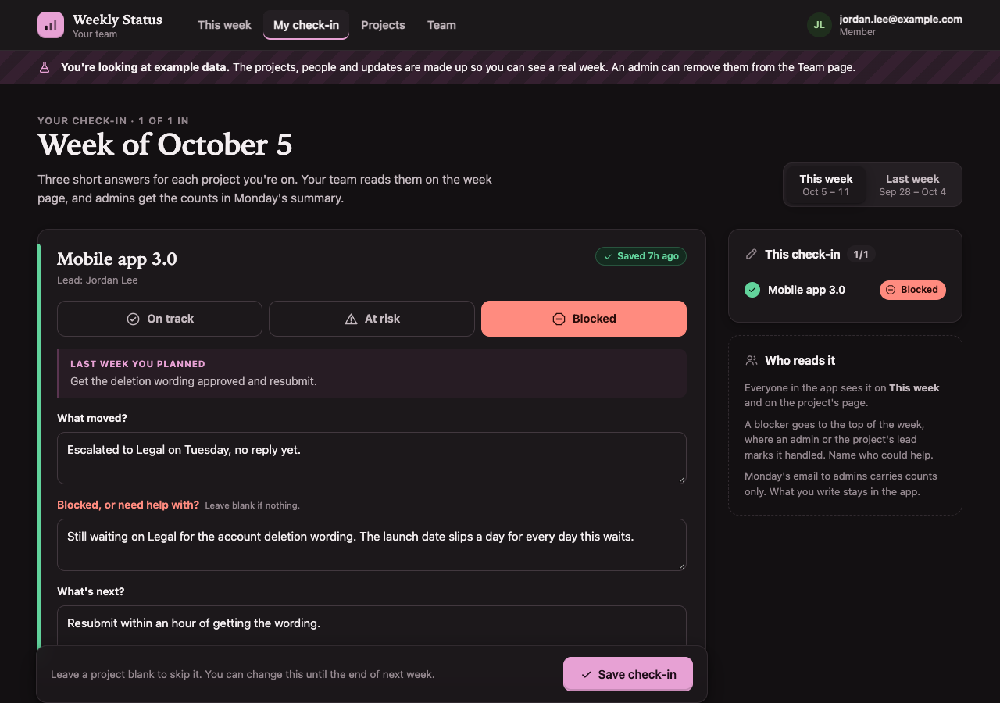
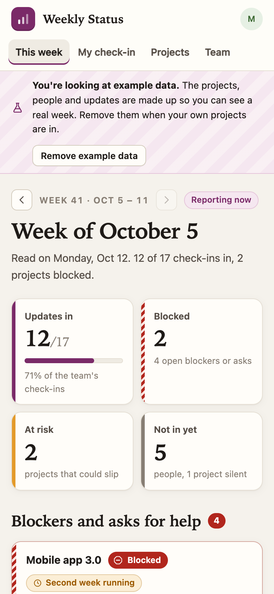

# Weekly Status

**Live demo:** [weekly-status.spryloom-com.spryloom.app](https://weekly-status.spryloom-com.spryloom.app). Sign in with your email to try it as a member of the example team. Anyone who signs in shares the demo, and it goes back to the example data every night.

The Monday status round-up, without the chasing. Each person answers three
short questions per project they're on. The PM opens one page and sees the
week: blockers first, who hasn't checked in, and which projects are slipping.


<p>
  
  
</p>

```
Thursday–Sunday     people write their check-in, one card per project
Friday 2 pm         a reminder to anyone not in yet
Monday 9 am         the summary to admins, then a last call to anyone still missing
Monday–Wednesday    the week page shows the week that just ended
```

Part of [spryloom/spryloom](https://github.com/spryloom/spryloom), MIT licensed.
Publish it as it is, or ask a coding agent to change it first.

## What it does

- **A weekly check-in per project.** On track, At risk or Blocked, then: what
  moved, what's blocked or needs help, what's next. Last week's "next" is shown
  above the form, so it's easy to say whether it happened. Blocked needs a
  reason; a status needs at least a line about what moved.
- **The week at a glance.** Updates in, blocked and at-risk projects, and how
  many people haven't checked in, at the top. Then every blocker and ask for
  help, flagged when it is the second week running. Then projects, worst first,
  each with who's in and a strip of its recent weeks. "Not in yet" lists people
  and the projects they owe, and who missed the week before too.
- **Blockers get handled.** An admin or the project's lead marks a blocker
  handled; it moves to a "handled" list. Editing the blocker reopens it.
- **History.** Step back through past weeks from the week page, or open a
  project to read it week by week.
- **Admins** add projects, set a lead, and paste in who checks in. Archiving a
  project stops the check-ins and keeps its history.
- **Example data on first run.** An app with no projects starts with five
  example projects, ten people at @example.com and four weeks of check-ins,
  labelled as examples. An admin removes them with one button. Anything your
  team wrote stays.

Everyone invited reads every check-in. It is a team tool, not a performance
review.

### Weeks

A week runs Monday to Sunday in the team's time zone (Team page, default
America/New_York). People can write or change this week's and last week's
check-in; older weeks are history. From Monday to Wednesday the week page
shows the week that just ended, because that's the one being read; from
Thursday, the current week.

## What gets emailed

Spryloom sends at most 5 emails a day for an app, so every email here is one
per person, never one per project, and nothing lives only in an email.

| Job | When | Who | What |
|---|---|---|---|
| `friday-reminder` | Fridays 2 pm | People not in yet | How many projects are waiting, with a button to the check-in |
| `monday-summary` | Mondays 9 am | Admins first, then anyone still missing | Counts for the week (in, blocked, at risk, silent projects, open blockers), with a button to the week page |

When more people are missing than there are emails left, those whose update
would leave a project with nothing at all go first, then those missing the
most projects, then those who missed the week before. On Monday the summary
goes to admins before any last call. The emails carry counts only: what
people typed stays in the app, where the button leads.

Admins are recorded as they open the app, so the summary reaches an admin
once they have opened it. Example people are never emailed. The job times
are in `spryloom.yaml`; keep their `timezone` the same as the one on the
Team page.

## Publish it

Add the other PMs or leads to `access.admins` in `spryloom.yaml`, then:

```
spry publish .
spry invite weekly-status --email teammate@yourcompany.com
```

The person who publishes is an admin. Add people to projects by email on the
Projects page and invite each of them to the app.

## Run it locally

```
npm install
createdb weekly_status
DATABASE_URL=postgres://localhost/weekly_status PORT=4101 node server.js
```

Spryloom tells the app who is signed in through two headers. Locally, send
them yourself:

```
curl -H 'x-spryloom-email: you@acme.com' -H 'x-spryloom-role: admin' localhost:4101/
curl -H 'x-spryloom-email: priya.shah@example.com' -H 'x-spryloom-role: user' localhost:4101/checkin
```

A browser extension that sets request headers does the same for a browser.
Run a job with the same `DATABASE_URL`, for example `node jobs/summary.js`;
without Spryloom's gateway it prints the emails instead of sending them.

## Change it

Ask your coding agent: "add a confidence score from 1 to 5 to each check-in",
"let leads see a summary of only their projects", "make the week start on
Sunday", "send the reminder on Thursday instead". Where things live:

- `lib/rules.js`: weeks, statuses, who's missing, permissions, and who gets
  the 5 emails a day
- `lib/views.js`: every page
- `lib/db.js`: tables, created on start
- `lib/examples.js`: the example data
- `jobs/remind.js`, `jobs/summary.js`: the two emails
- `public/app.css`, `public/app.js`: the styles, and small touches that the
  pages work without

```
npm test          rules and pages, no database needed
```
